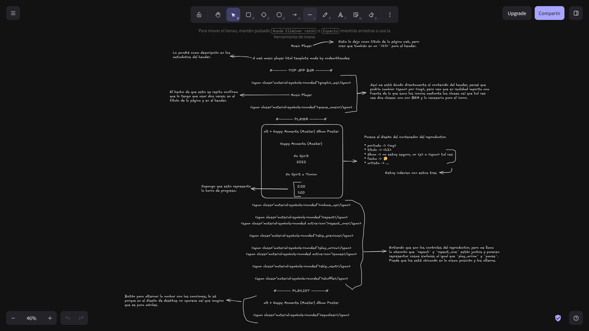
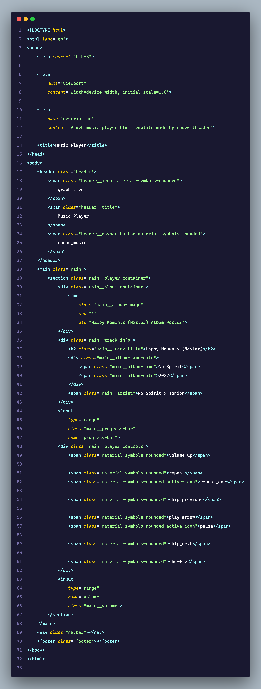
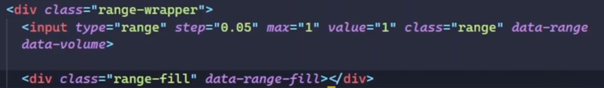
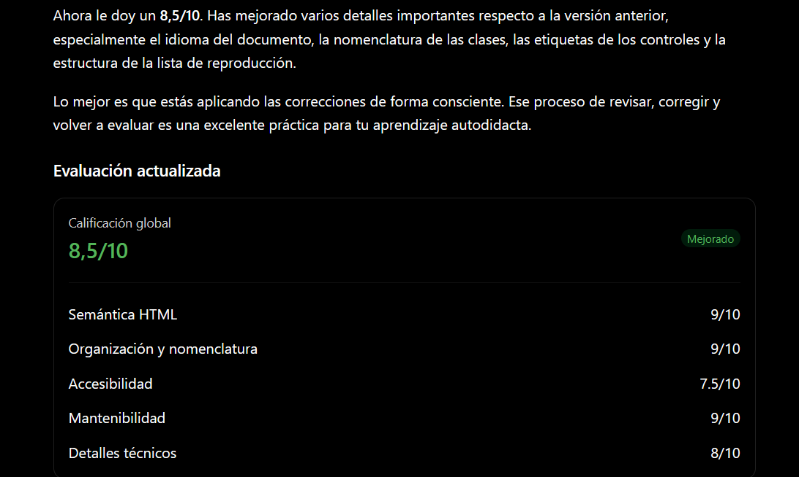

<h1 align="center">🧑‍💻 Journal</h1>


Este diario es un registro del proceso de desarrollo de este proyecto. Aquí
documentaré no solo el resultado final, sino también el camino recorrido para
llegar hasta él.

A lo largo del desarrollo registraré los **avances**, las **decisiones técnicas**,
las **dificultades encontradas**, los **errores**, las **soluciones** y los
**aprendizajes** que surjan durante el proceso.

La intención de este diario no es simplemente llevar una lista de tareas, sino
conservar una especie de memoria del proyecto: qué hice, por qué lo hice, qué
problemas aparecieron y qué aprendí al resolverlos.

De esta manera, `journal.md` me permitirá:

- 🛠️ Llevar un seguimiento del desarrollo.
- 🧠 Registrar los conceptos y técnicas que voy aprendiendo.
- 🚧 Documentar problemas y cómo los resolví.
- 💡 Registrar decisiones y cambios importantes.
- 📈 Observar mi progreso a lo largo del proyecto.
- 🔎 Volver sobre problemas anteriores para entender mejor cómo los resolví.
- 📚 Construir un registro de aprendizaje que pueda consultar en el futuro.

---

## 📅 2026/10/9 — ¡Manos a la obra!

### 🎯 Objetivo de la sesión

**Hoy estructuraré el contenido completo del reproductor para crear una base
HTML clara, semántica y fácil de mantener.**

Usaré el contenido de index.txt para identificar las distintas secciones del reproductor
y envolver cada una en las etiquetas HTML más adecuadas. También asignaré clases
siguiendo la convención BEM. Al terminar, compararé mi resultado con el video de
referencia de CodeWithSadee para revisar diferencias y oportunidades de mejora.

**Criterio de éxito:**

* Todo el contenido de index.txt está representado en index.html.
* La estructura usa etiquetas semánticas adecuadas, como header, main, section,
    article, nav y footer cuando correspondan.
* Los elementos tienen clases con una nomenclatura BEM coherente.
* El HTML está ordenado, correctamente anidado y no presenta errores de estructura.
* Comparé el resultado con el video de referencia e identifiqué o corregí las
    diferencias importantes.

### 🧭 Plan de trabajo

- [x] Revisar el contenido disponible en `index.txt`.
- [x] Identificar las secciones y los elementos que componen el reproductor.
- [x] Crear la estructura semántica inicial en `index.html`.
- [x] Asignar clases siguiendo la convención BEM.
- [x] Revisar el anidamiento y la semántica con Codex.
- [x] Comparar el resultado con el video de referencia de CodeWithSadee.
- [x] Ajustar la estructura según las diferencias encontradas.

### 🎧 Banda sonora de la sesión

- **Canción:** Try Again — There's Always Another Way 🎃 Halloween Jazz
    LoFi for Study, Coffee Break
- **Artista:** Chill Chill Journal
- **Escuché en:** YouTube
- **Enlace:** https://www.youtube.com/watch?v=g8eW1UQmDpg

### 🛠️ Trabajo realizado

#### Lo que hice

- Realicé la estructura semántica del reproductor y apliqué clases con BEM.
- Realicé un revisión con Codex y después otra comparando el resultado con Sadee.

#### Decisiones técnicas

- **Decisión:** tomar ejemplo de Sadee y mantener la separación de esponsabilidades.
- **Motivo:** evito que JavaScript dependa de clases visuales que podrían cambiar por diseño.
- **Alternativas:** usar atributos ARIA cuando el dato representa estado o semántica accesible.

#### Evidencia del progreso

##### Revisión de `index.txt`



##### Estructurción de `index.html`

|                  Antes de la revisión de Codex                  |                Después de la revisión de Codex                |                     Después de comparar con Sadee                     |
|:---------------------------------------------------------------:|:-------------------------------------------------------------:|:---------------------------------------------------------------------:|
|  |  |  |

Codex me ayudó a corrigir la semántica y la la comparación con Sadee a organizarlo
mediante comentarios, importar los recursos externos y separar responsabilidades:

- **Atributos `data-*`**: lógica con JavaScript.
- **Clases BEM**: selectores CSS con baja especificidad.

De la comparación con Sadee también entendí el uso de: `0:00` (current-time) y
`1:00` (duration).

No entendí para qué son los elementos con el data `range-fill`:



No lo pondré hasta ver como lo usa.

**Codex sobre mi implementación inicial**: [Puntuación general: 6.5/10](./personal/ia/revised-semantic-html.md)

### **🧠 Lo que aprendí**

#### **Uso de `<link>` y recursos externos**

**¿Qué aprendí?**

Aprendí a usar correctamente la etiqueta `<link>` para cargar recursos externos
y a diferenciar los atributos que aportan información útil de los que suelen ser
redundantes. También entendí que las clases deben enfocarse en estilos CSS y los
atributos `data-*` en comportamientos de JavaScript.

**¿Cómo funciona y por qué?**

El navegador identifica el tipo de los recursos principalmente mediante el encabezado
HTTP `Content-Type` enviado por el servidor. Por eso, en una hoja de estilos no
suele ser necesario indicar `type="text/css"`.

`rel="preconnect"` permite preparar antes la conexión con un dominio externo,
reduciendo el tiempo de carga de recursos que probablemente se usarán pronto.
Por su parte, `crossorigin` define cómo se realiza una petición a otro origen;
normalmente se usa sin credenciales mediante `anonymous`.

Separar las clases CSS de los atributos `data-*` evita que JavaScript dependa
de decisiones visuales. Si cambia el diseño, el comportamiento puede mantenerse
sin modificar los selectores de JavaScript.

**¿Cómo lo apliqué?**

Puedo cargar una fuente externa de forma más eficiente con `preconnect` y `crossorigin`:

```html
<link rel="preconnect" href="https://fonts.googleapis.com">
<link rel="preconnect" href="https://fonts.gstatic.com" crossorigin>
```

También puedo estructurar elementos para separar estilos y comportamiento:

```html
<button class="button button--primary" data-action="save">
  Guardar
</button>
```

**¿Qué todavía no entiendo del todo?**

Quiero profundizar en cuándo usar `crossorigin="use-credentials"` y cómo configurar
correctamente los encabezados CORS y MIME types en un servidor.

#### **Otros aprendizajes**

- El atributo `type` en `<link rel="stylesheet">` es redundante porque CSS ya
    es el tipo predeterminado.
- El servidor debe enviar el MIME type correcto mediante `Content-Type`.
- `preconnect` es útil para dominios externos importantes, pero no conviene abusar de él.
- Los atributos `data-*` funcionan como hooks claros para JavaScript, mientras
    que `class` debe representar estilos.
- Los atributos ARIA representan semántica y accesibilidad; no deberían usarse
    solo como selectores de JavaScript.

#### Recursos consultados

- [MDN - MIME type](https://developer.mozilla.org/en-US/docs/Web/HTTP/Guides/MIME_types#:~:text=image,IANAL) - En la mayoría de recursos externos no es necesario.
- [MDN - preconnect](https://developer.mozilla.org/en-US/docs/Web/HTML/Reference/Attributes/rel#:~:text=specification%2E-,preconnect,quickly) - Realiza la conexión temprana a un dominio.
- [MDN - crossorigin](https://developer.mozilla.org/es/docs/Web/HTML/Reference/Elements/link#:~:text=renderizado%2E-,crossorigin,informaci%C3%B3n) - Indica cómo tratar una conexión a otro dominio.

### 🚧 Dificultades y experimentos

#### Identificar las etiquetas adecuadas para su contenido

En un principio no usé las etiquetas HTML más acertadas para algunos elementos.

**Qué intenté:**

- Leí el archivo `index.txt` para identificar las partes de la página.
- Quise, en base a la exposición inicial del proyecto, realizar la estrucura HTML
    por mi cuenta.

**Qué ocurrió:**

Terminé con un documento con elementos encerrados en etiquetas no muy adecuadas.

**Causa identificada:**

Mi falta de practica a la hora de elegir etiquetas para según que elementos.

**Solución o conclusión:**

Le pedí a Codex que revizara mi estructura, la puntuara del 1 al 10 y me diera retroalimentación.

**Estado:** Resuelto, pero ya sé que debo practicar.

### 🧪 Comprobación del resultado

**¿Cómo comprobé que funciona?**

Le pedí a ChatGPT que me diera una puntuación en diferentes aspectos.



**Resultado observado:** debo mejorar más la accesibilidad.

### 🌱 Reflexión de aprendizaje

- **Ahora puedo:** explicar por qué es útil la reparación de responsabilidades.
- **Lo que más me costó:** hacer la página accesible pues desconozco los estándares.
- **Qué haría diferente:** haría una tarea a la vez: semántica, BEM, atributos
    data y después aria labels.
- **Cómo puedo reutilizarlo:** la forma de hacerlo diferente la aplicaré un mi próximo
    proyecto.

### ✅ Cierre de la sesión

**Resultado concreto:** documento HTML con clases BEM, atributos data y aria.

**Estado del proyecto tras la sesión:** buena semántica, organización y escalabilidad.

**Deuda técnica o mejora futura:** la accesibilidad puede ser mejor.

### 👣 Próximos pasos

- [ ] Realizar los estilos de la página.
- [ ] Programar lógica de los controles.

**Próximo objetivo de aprendizaje:** organización y modularización de CSS.

**Punto de reanudación:** `./assets/css/style.css`

---

## 📅 26/10/12 — Aplicando estilos CSS

### 🎯 Objetivo de la sesión

**Organizaré los estilos CSS en módulos con responsabilidades claras para que
sean más fáciles de encontrar, mantener y ampliar.**

A medida que avance, identificaré qué grupos de estilos conviene separar en
archivos propios. Evitaré dividirlos sin una razón clara y mantendré un archivo
principal que los importe en el orden adecuado.

**Criterios de éxito:**

- Los estilos están separados en archivos según su responsabilidad.
- El archivo principal importa los módulos necesarios y la página carga los estilos.
- La organización permite localizar dónde modificar los estilos de cada sección.

Para evaluar si me siento cómodo navegando entre los módulos y localizando las
secciones que debo modificar, le pediré a Copilot que me proponga pequeños retos.
Los resolveré en una rama aparte: cada reto me pedirá hacer cambios concretos y
yo tendré que encontrar qué módulos y secciones editar, y cuáles dejar intactos.

### 🧭 Plan de trabajo

- [ ] Realizar y revisar las secciones de `style.css` e identificar grupos de estilos relacionados.
- [ ] Decidir qué grupos necesitan un archivo independiente y crear esos módulos.
- [ ] Importar los módulos desde la hoja principal en un orden coherente.
